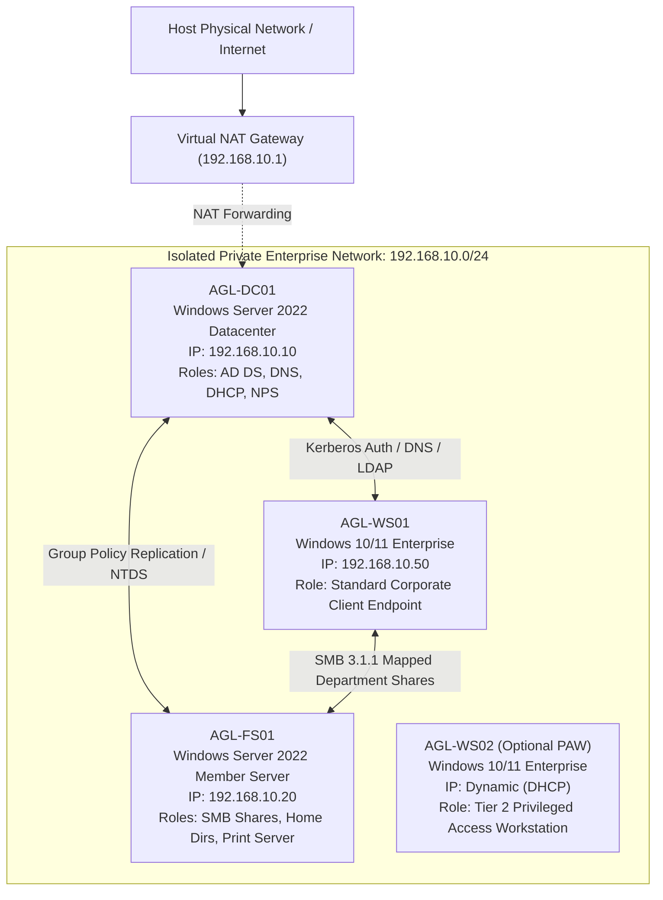
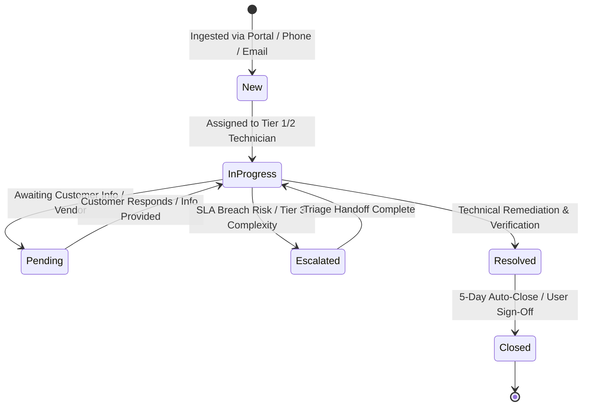

# Enterprise Active Directory & IT Service Desk Simulation Lab

[](https://www.microsoft.com/en-us/evalcenter/evaluate-windows-server-2022)
[](https://learn.microsoft.com/en-us/windows-server/identity/ad-ds/active-directory-domain-services)
[](https://github.com/PowerShell/PowerShell)
[](#4-itil-service-desk-framework)
[](https://www.servicenow.com/)
[](https://www.atlassian.com/software/jira/service-management)
[](.github/workflows/psscriptanalyzer.yml)
[](LICENSE)

An enterprise-grade, portfolio-ready simulation environment bridging **Windows Systems Administration & Identity Operations (Windows Server 2022, Active Directory DS, Group Policy, PowerShell automation)** with **ITIL Service Desk Operations (ServiceNow & Jira Service Management incident workflows, 10 real-world ticket runbooks, and 5 production SOPs)**.

---

## 📌 Executive Summary & Architecture Highlights

* **Simulated Corporate Domain**: `corp.apexlogistics.local` (NetBIOS: `APEX`), an enterprise logistics organization spanning 7 business units (Executive, IT, HR, Finance, Engineering, Logistics, Sales & Marketing).
* **Tiered Identity Security**: Full implementation of Microsoft's **Enterprise Access Model** (Tier 0 Identity/Domain Controllers, Tier 1 Member Servers, Tier 2 Client Workstations).
* **Least-Privilege RBAC**: Granular `dsacls` delegation granting Tier 1/2 Service Desk technicians rights to unlock accounts, reset passwords, and modify contact attributes without requiring `Domain Admins` privileges.
* **Production-Grade Automation**: Modular PowerShell scripts featuring `[CmdletBinding()]`, strict parameter handling, error handling, NTFS ACL inheritance controls, and bulk ingestion of **100+ simulated enterprise users**.
* **ITIL Service Management**: Comprehensive SLA matrix (15-min Critical P1 to 48-hr P4 Request), queue architecture, 10 fully resolved incident and request runbooks, and 5 operational Standard Operating Procedures (SOPs).

---

## 🏗️ Architectural Topology

### 1. Enterprise Network Architecture (`192.168.10.0/24`)



---

### 2. Active Directory Organizational Unit (OU) Hierarchy

```
corp.apexlogistics.local
└── ApexGlobal (Root Corporate Container)
    ├── Administration (Tiered Privileged Identity Management)
    │   ├── Tier0-DomainAdmin (Domain Controllers & Identity Plane Admins)
    │   ├── Tier1-ServerAdmin (Member Servers & Infrastructure Admins)
    │   └── Tier2-ServiceDesk (Workstation Support & Help Desk Technicians)
    ├── Departments (Standard Business Personnel)
    │   ├── Executive (C-Suite, VP Leadership)
    │   ├── InformationTechnology (Systems, Security, Service Desk)
    │   ├── HumanResources (People Ops, Talent Acquisition)
    │   ├── Finance (Accounting, Controllers, Payroll)
    │   ├── Engineering (Software Developers, DevOps, QA)
    │   ├── Logistics (Supply Chain, Fleet, Dispatchers)
    │   └── SalesMarketing (Account Executives, Marketing)
    ├── Groups (AGDLP Role-Based Access Control)
    │   ├── Security-RBAC (Privileged & Capability Security Groups)
    │   ├── Security-Departmental (Department Membership Groups)
    │   └── Distribution-Lists (Universal Broadcast & Notification Lists)
    ├── Devices (Corporate Hardware Assets)
    │   ├── Servers (Tier 1 Member Servers)
    │   └── Workstations (Tier 2 Corporate Desktops & Laptops)
    ├── ServiceAccounts (Managed Service Accounts & Service Principals)
    └── Terminated (Quarantine OU for Offboarded Accounts)
```

---

### 3. ITIL Ticket Lifecycle & Service Desk Workflow



---

## ⚡ PowerShell Automation Suite

All scripts reside in the [`/scripts`](scripts/) directory and adhere to strict enterprise scripting standards:

| Script | Purpose & Capabilities | Key Cmdlets / Tools |
|:---|:---|:---|
| [`01_Setup-DomainController.ps1`](scripts/01_Setup-DomainController.ps1) | Configures static IP (`192.168.10.10`), DNS loopback, installs AD DS and DNS roles, and promotes the server to root DC for `corp.apexlogistics.local`. | `New-NetIPAddress`, `Install-WindowsFeature`, `Install-ADDSForest` |
| [`02_Build-OUStructure.ps1`](scripts/02_Build-OUStructure.ps1) | Builds the complete corporate OU hierarchy with `ProtectedFromAccidentalDeletion = $true`. | `New-ADOrganizationalUnit` |
| [`03_Create-SecurityGroups.ps1`](scripts/03_Create-SecurityGroups.ps1) | Provisions AGDLP security groups (RBAC, departmental, and resource-access groups). | `New-ADGroup` |
| [`04_BulkProvision-Users.ps1`](scripts/04_BulkProvision-Users.ps1) | Ingests [`data/users_dataset.csv`](data/users_dataset.csv) (100+ records), sets attributes, assigns OUs, populates groups, and creates user home folders with strict NTFS ACLs. | `Import-Csv`, `New-ADUser`, `Add-ADGroupMember`, `Set-Acl` |
| [`05_Delegate-ServiceDeskPermissions.ps1`](scripts/05_Delegate-ServiceDeskPermissions.ps1) | Applies granular ACLs over `OU=Departments` authorizing `SEC-ServiceDesk-Tier1` to unlock accounts and reset passwords without Domain Admin rights. | `dsacls.exe`, `ActiveDirectory` ACLs |
| [`06_Deploy-GPOBaselines.ps1`](scripts/06_Deploy-GPOBaselines.ps1) | Creates and links GPOs: Legal logon warning banner, 15-minute screen timeout lock, PowerShell Script Block Logging (Event 4104), and LLMNR mitigation. | `New-GPO`, `New-GPLink`, `Set-GPRegistryValue` |
| [`07_DailyOps-ServiceDeskToolkit.ps1`](scripts/07_DailyOps-ServiceDeskToolkit.ps1) | Interactive menu-driven console tool for Help Desk agents: User search, 1-click password reset/unlock, group manager, and employee offboarding. | `Get-ADUser`, `Unlock-ADAccount`, `Set-ADAccountPassword` |

---

## 🎫 ITIL Incident & Service Request Catalog

The [`/service-desk/tickets`](service-desk/tickets/) directory contains 10 comprehensive ticket runbooks modeled after ServiceNow and Jira Service Management:

| Ticket ID | Priority | Scenario Description | Key Diagnostic & Remediation Steps | Runbook |
|:---:|:---:|:---|:---|:---:|
| **INC-1001** | **P1 Critical** | Domain-wide authentication outage; DC SRV records missing | Diagnosed Netlogon startup race condition; executed `nltest /dsregdns`, registered DNS zone cache, set registry service dependency. | [Runbook](service-desk/tickets/INC-1001_P1_DNS_Authentication_Failure.md) |
| **INC-1002** | **P2 High** | CFO locked out 15 mins before Board Earnings Call | Queried Event ID 4740 on DC to identify caller station (`VIC-IPAD-PRO` cached password); unlocked account under VIP SLA. | [Runbook](service-desk/tickets/INC-1002_P2_VIP_Executive_Account_Lockout.md) |
| **INC-1003** | **P2 High** | Finance Department mapped share (`\\AGL-FS01\Finance`) Access Denied | Diagnosed stripped NTFS inheritance following backup restore; rebuilt ACLs via PowerShell granting `DL-Share-Finance-RW`. | [Runbook](service-desk/tickets/INC-1003_P2_Finance_Share_Access_Denied.md) |
| **INC-1004** | **P3 Medium** | Employee reports credential-harvesting phishing email | Contained account within 4 mins; revoked Azure AD / M365 refresh tokens, ran compliance search to purge email enterprise-wide. | [Runbook](service-desk/tickets/INC-1004_P3_Phishing_Incident_Triage.md) |
| **INC-1005** | **P3 Medium** | Workstation failing to receive security banner GPO | Executed `gpresult /r`; corrected missing `Authenticated Users` Read permissions per Microsoft MS16-072 security requirements. | [Runbook](service-desk/tickets/INC-1005_P3_GPO_Replication_Failure.md) |
| **INC-1006** | **P3 Medium** | Logistics dispatch thermal printer offline with 18 stuck jobs | Remoted to print server via WinRM; stopped Spooler service, purged corrupted `.SHD` and `.SPL` files, restored print queue. | [Runbook](service-desk/tickets/INC-1006_P3_Logistics_Printer_Mapping.md) |
| **INC-1007** | **P3 Medium** | Remote manager denied access to corporate SSL-VPN | Analyzed Network Policy Server (NPS) Event 6273 (Reason-Code 65); added user to required Active Directory group `SEC-VPN-Users`. | [Runbook](service-desk/tickets/INC-1007_P3_VPN_Access_Denied.md) |
| **SR-2001** | **P4 Low** | Senior Logistics Coordinator new hire onboarding request | Automated AD user provisioning, group memberships (`GLB-Logistics-Staff`), email, and home folder creation with NTFS ACLs. | [Runbook](service-desk/tickets/SR-2001_P4_New_Hire_Onboarding.md) |
| **SR-2002** | **P4 Low** | Immediate security offboarding for terminated sales employee | Disabled AD account, scrambled password to 32 chars, revoked cloud tokens, stripped group memberships, moved to `OU=Terminated`. | [Runbook](service-desk/tickets/SR-2002_P4_Immediate_User_Offboarding.md) |
| **SR-2003** | **P4 Low** | Remote employee prompted for 48-digit BitLocker key | Verified identity out-of-band; queried Active Directory `msFVE-RecoveryInformation` object; resealed TPM protectors. | [Runbook](service-desk/tickets/SR-2003_P4_BitLocker_Key_Retrieval.md) |

---

## 📖 Standard Operating Procedures (SOPs)

Standardized operational guidelines for Tier 1 and Tier 2 IT support staff:

* [**SOP-001: User Account Lockout Triage & Password Reset**](sop/SOP-001_User-Account-Lockout-and-Password-Reset.md) — Caller verification rules, CLI toolkit usage, Event 4740 root cause triage.
* [**SOP-002: Employee Onboarding & Account Provisioning**](sop/SOP-002_Employee-Onboarding-and-Provisioning.md) — Intake validation, sAMAccountName standards, OU placement, NTFS home folder ACLs.
* [**SOP-003: Employee Offboarding & Security Revocation**](sop/SOP-003_Employee-Offboarding-and-Security-Revocation.md) — Immediate token revocation, group stripping, quarantine OU placement, mailbox delegation.
* [**SOP-004: BitLocker Drive Encryption Recovery Key Retrieval**](sop/SOP-004_BitLocker-Drive-Recovery.md) — Positive asset custodian validation, AD DS key querying, and TPM protector reset.
* [**SOP-005: Shared Folder NTFS & Share Permissions Management**](sop/SOP-005_Shared-Folder-NTFS-and-Share-Permissions.md) — Share vs. NTFS permission evaluation, AGDLP model, Kerberos TGT token refresh.

---

## 🚀 Quick Start & Lab Deployment Guide

### 1. Lab Environment Options
- **Hyper-V Guide**: Follow the [`docs/guides/hyperv-setup-guide.md`](docs/guides/hyperv-setup-guide.md) to create the internal switch, NAT network, and VMs.
- **VirtualBox / VMware Guide**: Follow the [`docs/guides/virtualbox-setup-guide.md`](docs/guides/virtualbox-setup-guide.md) for cross-platform hypervisors.

### 2. Execution Order (Run as Administrator on `AGL-DC01`):

```powershell
# 1. Promote Windows Server 2022 to Domain Controller (Auto-reboots upon completion)
.\scripts\01_Setup-DomainController.ps1

# 2. Build the Enterprise OU Hierarchy
.\scripts\02_Build-OUStructure.ps1

# 3. Create Security and RBAC Groups
.\scripts\03_Create-SecurityGroups.ps1

# 4. Bulk Provision 100+ Enterprise Users from CSV
.\scripts\04_BulkProvision-Users.ps1

# 5. Delegate Least-Privilege Permissions to Service Desk
.\scripts\05_Delegate-ServiceDeskPermissions.ps1

# 6. Deploy Group Policy Baselines (Banner, Screen Timeout, Script Logging)
.\scripts\06_Deploy-GPOBaselines.ps1

# 7. Launch Daily Operations Service Desk Console
.\scripts\07_DailyOps-ServiceDeskToolkit.ps1
```

### 3. Verify Code Quality Locally
```powershell
# Run Abstract Syntax Tree parser test
.\tests\Test-ScriptsSyntax.ps1
```

---

## 💼 Resume & Interview Preparation

* **[Resume Bullets Guide](portfolio/RESUME_BULLETS.md)**: Ready-to-copy, metrics-driven bullet points tailored for IT Support Specialist, Desktop Support, Junior Systems Administrator, and IAM Analyst roles.
* **[Interview Talking Points (STAR Method)](portfolio/INTERVIEW_TALKING_POINTS.md)**: Structured responses to real-world behavioral and technical interview questions based on scenarios simulated in this lab.

---

## 📂 Repository File Structure

```
├── .github/
│   └── workflows/
│       └── psscriptanalyzer.yml          # Automated CI/CD script quality linting
├── docs/
│   ├── architecture/
│   │   ├── lab-network-topology.md       # IP schema, virtual switch & firewall ports
│   │   ├── active-directory-design.md    # Domain FQDN, OU architecture & AGDLP
│   │   └── tiered-admin-model.md         # Microsoft Tier 0-2 & Credential Protection
│   ├── guides/
│   │   ├── hyperv-setup-guide.md         # Step-by-step Hyper-V VM provisioning
│   │   └── virtualbox-setup-guide.md     # Step-by-step VirtualBox / VMware guide
│   ├── itil/
│   │   ├── servicenow-jira-framework.md  # SLA matrices, workflows & custom fields
│   │   └── escalation-matrix.md          # Tier 1 -> Tier 2 -> SysAdmin escalation paths
│   └── superpowers/                      # Engineering specs and execution plans
├── scripts/
│   ├── 01_Setup-DomainController.ps1     # DC promotion & static network config
│   ├── 02_Build-OUStructure.ps1          # Enterprise OU tree automation
│   ├── 03_Create-SecurityGroups.ps1      # Departmental, RBAC & resource groups
│   ├── 04_BulkProvision-Users.ps1        # CSV ingestion & 100+ user creation
│   ├── 05_Delegate-ServiceDeskPermissions.ps1 # Least-privilege Service Desk ACLs
│   ├── 06_Deploy-GPOBaselines.ps1        # Automated GPO policies & links
│   └── 07_DailyOps-ServiceDeskToolkit.ps1 # Interactive Tier 1/2 operations CLI tool
├── data/
│   └── users_dataset.csv                 # 100+ realistic enterprise employees
├── service-desk/
│   └── tickets/                          # 10 Incident & Service Request runbooks
│       ├── INC-1001_P1_DNS_Authentication_Failure.md
│       ├── INC-1002_P2_VIP_Executive_Account_Lockout.md
│       ├── INC-1003_P2_Finance_Share_Access_Denied.md
│       ├── INC-1004_P3_Phishing_Incident_Triage.md
│       ├── INC-1005_P3_GPO_Replication_Failure.md
│       ├── INC-1006_P3_Logistics_Printer_Mapping.md
│       ├── INC-1007_P3_VPN_Access_Denied.md
│       ├── SR-2001_P4_New_Hire_Onboarding.md
│       ├── SR-2002_P4_Immediate_User_Offboarding.md
│       └── SR-2003_P4_BitLocker_Key_Retrieval.md
├── sop/                                  # 5 Standard Operating Procedures
│   ├── SOP-001_User-Account-Lockout-and-Password-Reset.md
│   ├── SOP-002_Employee-Onboarding-and-Provisioning.md
│   ├── SOP-003_Employee-Offboarding-and-Security-Revocation.md
│   ├── SOP-004_BitLocker-Drive-Recovery.md
│   └── SOP-005_Shared-Folder-NTFS-and-Share-Permissions.md
├── portfolio/
│   ├── RESUME_BULLETS.md                 # Tailored CV bullet points
│   └── INTERVIEW_TALKING_POINTS.md       # STAR method technical interview prep
├── tests/
│   └── Test-ScriptsSyntax.ps1            # Automated PowerShell AST syntax validator
├── LICENSE                               # MIT License
└── README.md                             # Flagship documentation landing page
```

---

## 📜 License
This project is open-source and distributed under the [MIT License](LICENSE).
