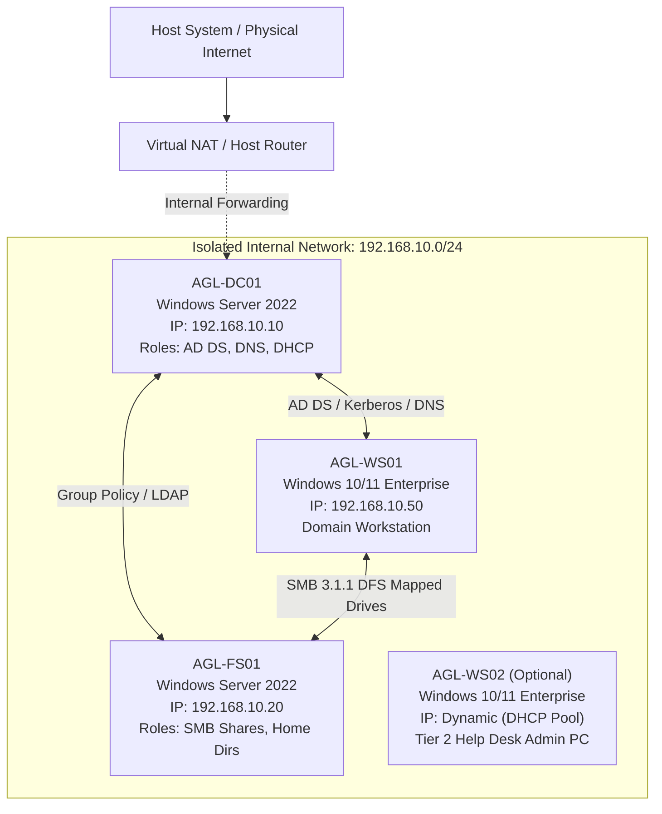

# Lab Network Architecture & Topology

## 1. Network Overview
The **Apex Global Logistics (AGL)** simulation environment is designed as an isolated enterprise perimeter network. All production traffic is contained within a private virtual network (`192.168.10.0/24`) to eliminate accidental exposure to external networks while faithfully reproducing corporate identity, routing, and DNS resolution behaviors.

---

## 2. IP Addressing Schema

| Node Hostname | Operating System | Network Adapter Type | IP Address | Subnet Mask | Default Gateway | Primary DNS | Secondary DNS | Roles & Purpose |
|:---|:---|:---|:---|:---|:---|:---|:---|:---|
| **`AGL-DC01`** | Windows Server 2022 Datacenter | Static (Internal vSwitch) | `192.168.10.10` | `255.255.255.0` | `192.168.10.1` | `127.0.0.1` | `8.8.8.8` (Forwarder) | Primary Domain Controller, AD DS, DNS Root, DHCP Scope Provider |
| **`AGL-FS01`** | Windows Server 2022 Datacenter | Static (Internal vSwitch) | `192.168.10.20` | `255.255.255.0` | `192.168.10.1` | `192.168.10.10` | None | Enterprise File Server, Departmental Shares (`\\AGL-FS01\Shares`), User Home Dirs |
| **`AGL-WS01`** | Windows 10/11 Pro/Enterprise | DHCP or Static (Internal) | `192.168.10.50` | `255.255.255.0` | `192.168.10.1` | `192.168.10.10` | None | Standard Enterprise Client Endpoint, GPO target, Incident verification machine |
| **`AGL-WS02`** | Windows 10/11 Pro/Enterprise | DHCP (Internal Pool) | `192.168.10.51` | `255.255.255.0` | `192.168.10.1` | `192.168.10.10` | None | Dedicated Privileged Access Workstation (PAW) for Tier 2 Service Desk technicians |

---

## 3. DHCP Scope Configuration
When DHCP is activated on `AGL-DC01`:
* **Scope Name**: `AGL-Corporate-Clients`
* **Address Range**: `192.168.10.100` – `192.168.10.200`
* **Subnet Mask**: `255.255.255.0`
* **Lease Duration**: 8 Days (Standard Enterprise)
* **Scope Options**:
  * Option 003 (Router / Default Gateway): `192.168.10.1`
  * Option 006 (DNS Servers): `192.168.10.10`
  * Option 015 (DNS Domain Name): `corp.apexlogistics.local`

---

## 4. Virtual Switch Architecture
To prevent IP conflicts with your physical home/office local router, the lab leverages a dedicated private/internal switch:
1. **Hyper-V**: Internal Virtual Switch (`AGL-Lab-Internal`) with a NAT Gateway configured via PowerShell `New-NetNat`.
2. **VirtualBox**: Internal Network mode named `AGL-Net` (or "Host-Only Adapter" with custom DHCP disabled).
3. **VMware Workstation**: Custom VMnet (e.g., `VMnet2` / Host-Only with private subnet `192.168.10.0`).

---

## 5. Firewall & Port Requirements
The following core ports are verified open between endpoints within `192.168.10.0/24`:
* **Port 53 (TCP/UDP)**: Domain Name System (DNS)
* **Port 88 (TCP/UDP)**: Kerberos Authentication
* **Port 135 (TCP)**: RPC Endpoint Mapper
* **Port 389 (TCP/UDP)**: Lightweight Directory Access Protocol (LDAP)
* **Port 445 (TCP)**: Server Message Block (SMB over IP)
* **Port 636 (TCP)**: LDAP over SSL (LDAPS)
* **Port 3268 (TCP)**: Global Catalog
* **Port 5985/5986 (TCP)**: Windows Remote Management (WinRM - PowerShell Remoting)
