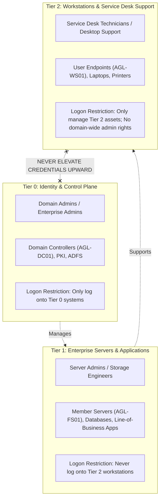

# Enterprise Tiered Administration Model & Delegation Framework

## 1. Overview & Threat Model
In legacy Active Directory deployments, IT Support and Help Desk technicians were often granted `Domain Admins` privileges to perform routine tasks like resetting passwords or joining computers to the domain. This anti-pattern introduces severe security risks:
- If a Help Desk technician logs into an infected workstation using a Domain Admin account, cached Kerberos tickets and NTLM credentials in memory (`LSASS.exe`) can be harvested by attackers using tools like Mimikatz or Pass-the-Hash (PtH).
- The attacker escalates instantly from a single compromised workstation to complete forest compromise.

To prevent lateral movement and credential harvesting, **Apex Global Logistics** implements the **Microsoft Enterprise Access Model** (Tiered Administration).

---

## 2. Tier Definitions & Scope

### Tier 0: Identity Plane
* **Scope**: Control of Active Directory, identity stores, Domain Controllers (`AGL-DC01`), and forest-wide security policies.
* **Accounts**: `admin-t0-*` (e.g., `admin-t0-jsmith`).
* **Enforcement**: Tier 0 accounts are strictly blocked via GPO User Rights Assignment (`Deny log on locally`, `Deny log on through Remote Desktop Services`) from logging into Tier 1 servers and Tier 2 workstations.

### Tier 1: Server Infrastructure
* **Scope**: Enterprise member servers, departmental file servers (`AGL-FS01`), web servers, and database instances.
* **Accounts**: `admin-t1-*`.
* **Enforcement**: Tier 1 accounts have local administrative rights on servers, but cannot manage Domain Controllers or log onto client laptops.

### Tier 2: Workstation & User Support (Service Desk)
* **Scope**: Corporate client endpoints (`AGL-WS01`), network printers, and standard departmental users (`OU=Departments`).
* **Accounts**: `admin-t2-*` or standard Help Desk analyst credentials.
* **Enforcement**: Protected by **Microsoft LAPS** (Local Administrator Password Solution) for local device recovery. Service Desk staff interact with Active Directory using **Delegation of Control**.

---

## 3. Least-Privilege Delegation of Control
Rather than assigning high-privilege built-in roles, the security group `SEC-ServiceDesk-Tier1` is granted explicit, granular permissions on `OU=Departments,OU=ApexGlobal,DC=corp,DC=apexlogistics,DC=local`:

| Delegated Capability | Underlying Active Directory Permission | Justification |
|:---|:---|:---|
| **Password Reset** | `Reset Password` on User Objects | Enables Tier 1 agents to service standard forgotten password tickets. |
| **Account Unlock** | Write permission to `lockoutTime` attribute | Unlocks accounts locked out by brute-force/bad password attempts without needing Domain Admin. |
| **Enforce Change at Logon** | Write permission to `pwdLastSet` attribute | Forces user to set their own private password upon initial temporary reset. |
| **Modify Contact Info** | Write permissions to `telephoneNumber`, `title`, `physicalDeliveryOfficeName` | Keeps corporate directory contact information up to date. |
| **Manage Group Membership** | Write `member` property on specified `OU=Groups\OU=Security-Departmental` | Allows Help Desk to add/remove users from departmental shares upon ticket approval. |
| **Read BitLocker Recovery Keys** | Read permission on `msFVE-RecoveryInformation` objects (Tier 2 only) | Enables Tier 2 desktop support to assist users locked out by BitLocker without exposing DC administrative tools. |

---

## 4. Administrative Separation in Practice
1. **Daily Work**: Technicians browse the web, check tickets in ServiceNow/Jira, and read emails using an unprivileged standard domain user account (`jsmith`).
2. **Administrative Tasks**: When performing Active Directory operations or workstation maintenance, technicians elevate using their separate Tier 2 credential (`admin-t2-jsmith`) or run administrative tools through the **Daily Operations Service Desk Toolkit**.
