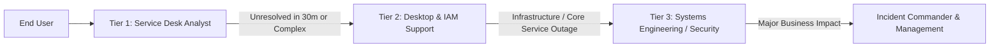

# Service Desk Escalation Matrix & Incident Governance

## 1. Purpose & Principles
The Escalation Matrix provides unambiguous pathways for routing tickets when:
- An issue exceeds the technical capability or delegated permissions of the current support tier.
- A ticket approaches or breaches its SLA threshold.
- A critical business disruption (P1/P2) occurs requiring executive awareness and coordinated engineering triage.

---

## 2. Tier Support Roster & Competency Scope

### Tier 1: IT Help Desk Analyst
- **Primary Goal**: First-Contact Resolution (FCR) target $\ge 70\%$.
- **Authorized Scope**:
  - User identity verification, account unlock, and password resets via `07_DailyOps-ServiceDeskToolkit.ps1`.
  - Standard pre-approved software deployments.
  - Basic workstation connectivity troubleshooting (ping, ipconfig, flushdns).
- **Time Threshold**: If diagnostic steps do not identify a path to resolution within **30 minutes**, escalate to Tier 2.

### Tier 2: Desktop Support & Identity Operations
- **Authorized Scope**:
  - Advanced endpoint diagnostics (driver corruption, Windows OS repair, BitLocker recovery keys).
  - Group Policy client-side extension troubleshooting (`gpresult /h`).
  - Active Directory departmental group modifications and file share permission triage.
  - Workstation imaging and hardware lifecycle replacement.
- **Time Threshold**: If an issue remains unresolved after **60 minutes** (for P2) or **2 hours** (for P3), escalate to Tier 3.

### Tier 3: Systems Engineering & Infrastructure
- **Authorized Scope**:
  - Windows Server 2022 domain controller health, NTDS replication, and FSMO roles.
  - Active Directory schema, DNS forwarders, and Kerberos ticket-granting services.
  - Enterprise Group Policy creation, modification, and WMI filtering.
  - Enterprise storage permissions, SMB shares, and DFS replication.

---

## 3. Escalation Triggers

| Trigger Category | Condition | Immediate Action |
|:---|:---|:---|
| **SLA Time Breach** | 50% of resolution SLA elapsed without progress | Ticket reassigned to next higher tier; notification sent to Service Desk Team Lead. |
| **Privilege Boundary** | Requires changes to Domain Controllers or Forest Policy | Reassign from Tier 1/2 to Tier 3 Systems Administration queue. |
| **VIP Status** | Affected caller is Executive leadership (C-Suite, VP) | Auto-tag as P2 High; notify Service Desk Lead; prioritize over non-urgent tickets. |
| **Security Incident** | Suspected malware, ransomware, credential harvesting, unauthorized admin activity | Immediate transfer to Information Security Analyst queue; isolate host from network. |
| **Major Incident (P1)** | Widespread disruption affecting 10+ users or core business workflow | Declare Major Incident; initiate bridge call; assign Incident Commander. |

---

## 4. Major Incident Management (MIM) Workflow (P1 / P2)

When an incident is classified as **P1 Critical**:
1. **Bridge Activation (T+5 minutes)**: Service Desk Team Lead activates emergency MS Teams bridge / War Room.
2. **Notification Cadence**:
   - Executive briefing email sent every 30 minutes until resolution.
   - Status page updated with initial alert: *"We are currently investigating an issue impacting network authentication."*
3. **Roles Designated**:
   - **Incident Commander (IT Director / Team Lead)**: Directs triage, manages communication, shields engineers from distractions.
   - **Lead Technical Investigator (Senior SysAdmin)**: Diagnoses root cause, tests remediation in lab/staging.
   - **Scribe / Communications Lead**: Documents exact chronological event log in ticket.
4. **Post-Incident Review (PIR)**:
   - Mandatory PIR meeting held within 24 hours of incident closure.
   - Formal Root Cause Analysis (RCA) document published covering: Timeline, Root Cause, Remediation, and Preventative Actions.
