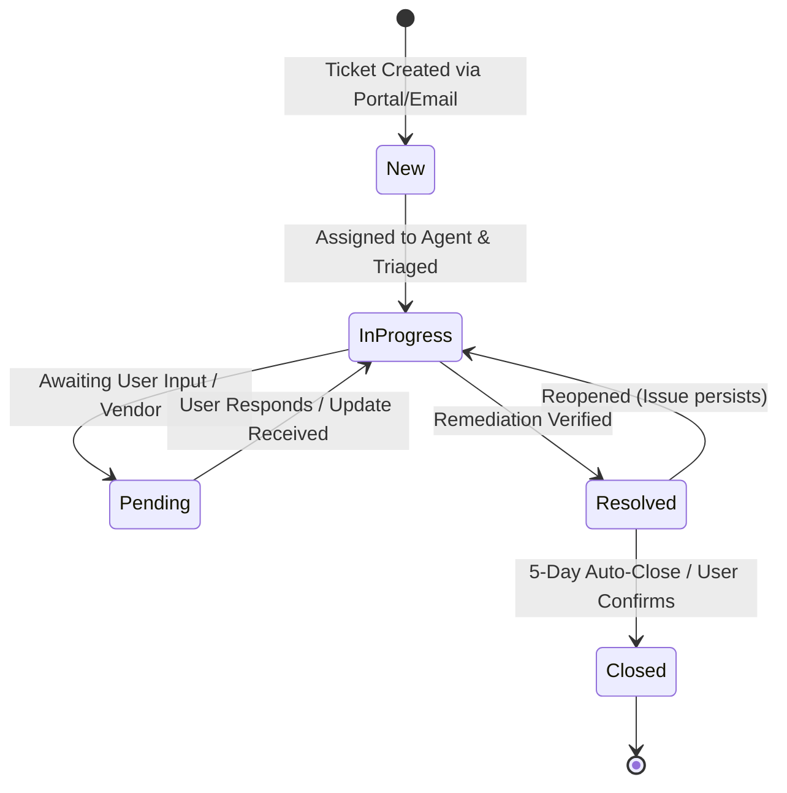

# ITIL Service Management Framework: ServiceNow & Jira Service Management

## 1. Overview & Scope
This framework defines the operational service management structure for **Apex Global Logistics (AGL)**, aligned with **ITIL v4** guidelines and modeled after enterprise deployments of **ServiceNow ITSM** and **Jira Service Management (JSM)**.

It governs how the IT Service Desk and Systems Administration teams triage, escalate, resolve, and document all technological incidents and service requests.

---

## 2. Incident vs. Service Request Classification

| Parameter | Incident Management (INC) | Service Request Fulfillment (SR) |
|:---|:---|:---|
| **Definition** | An unplanned interruption to or quality reduction of an IT service. | A formal user request for something to be provided (access, hardware, software, information). |
| **Primary Goal** | Restore normal service operation as rapidly as possible with minimal business disruption. | Provide pre-approved, standard service deliverables efficiently within agreed SLAs. |
| **Examples** | Domain Controller DNS failure, Outlook cannot connect to server, network share inaccessible, printer offline. | New employee onboarding, password reset request, access to shared drive, software installation. |
| **Workflow** | Triage $\rightarrow$ Investigate $\rightarrow$ Workaround/Fix $\rightarrow$ Root Cause $\rightarrow$ Resolve. | Approval (if required) $\rightarrow$ Automated/Manual Fulfillment $\rightarrow$ Verify $\rightarrow$ Complete. |

---

## 3. Priority Determination Matrix (Impact vs. Urgency)

Priority is determined objectively through the intersection of **Impact** (breadth of business affected) and **Urgency** (time criticality of resolution):

| Urgency \ Impact | High (Organization-wide) | Medium (Department / Group) | Low (Single User) |
|:---|:---:|:---:|:---:|
| **High** (Critical business deadline / VIP) | **P1 - Critical** | **P2 - High** | **P3 - Medium** |
| **Medium** (Standard operations impacted) | **P2 - High** | **P3 - Medium** | **P4 - Low** |
| **Low** (Workaround exists / Non-urgent) | **P3 - Medium** | **P4 - Low** | **P4 - Low** |

---

## 4. Service Level Agreement (SLA) Targets

| Priority Level | Description | Initial Response SLA | Target Resolution SLA | Service Coverage Window | Breach Escalation |
|:---|:---|:---:|:---:|:---:|:---|
| **P1 - Critical** | Enterprise outage, DC unreachable, domain authentication down | **15 Minutes** | **2 Hours** | 24/7/365 | Immediate notification to CIO, IT Director & Lead SysAdmin |
| **P2 - High** | Departmental share offline, VIP Executive lockout before board call | **30 Minutes** | **4 Hours** | 07:00 – 19:00 EST | Escalates to Tier 2 Lead after 60 mins of inactivity |
| **P3 - Medium** | Single user workstation issue, GPO not applying, VPN client fault | **2 Hours** | **8 Hours** | 08:00 – 18:00 EST | Escalates to Tier 2 if unresolved at 4 hours |
| **P4 - Low** | Routine service requests, new user provisioning, equipment requests | **4 Hours** | **48 Hours** | Business Hours | Standard Service Desk queue fulfillment |

*Note: SLA timers automatically pause when a ticket is in **Pending / On Hold** state with pending customer information (`Waiting on Customer`) or external vendor resolution (`Waiting on Vendor`).*

---

## 5. Ticket Lifecycle & State Transition Model

Both ServiceNow and Jira Service Management follow an explicit state transition machine:



### State Definitions:
1. **New / Open**: Ticket ingested; awaiting triage and queue assignment.
2. **Assigned / In Progress**: Work is actively underway by assigned technician.
3. **Pending / On Hold**: SLA clock paused; sub-status must be selected:
   - `Waiting on User` (additional details requested from caller).
   - `Waiting on Vendor` (third-party hardware/software support).
   - `Pending Change` (requires scheduled Change Request / RFC approval).
4. **Resolved**: Service restored; resolution code and mandatory resolution notes populated.
5. **Closed**: Permanent archival state after 5 business days without user objection.

---

## 6. Enterprise Data Schema & Custom Fields

Standardized fields required across ServiceNow and Jira Service Management:

| Field Name | Type | Options / Format | Description |
|:---|:---|:---|:---|
| **Number** | System Key | `INC-100X` or `SR-200X` | Unique ticket identifier. |
| **Caller / Reporter** | User Reference | Full Name (`evance`, `msterling`) | The employee experiencing or requesting service. |
| **Category** | Dropdown | `Identity & Access`, `Network`, `Hardware`, `Software`, `Storage` | High-level categorization for reporting. |
| **Subcategory** | Dropdown | `Password/Lockout`, `Active Directory`, `Group Policy`, `File Share`, `VPN` | Granular issue classification. |
| **Configuration Item (CI)** | CMDB Ref | `AGL-DC01`, `AGL-FS01`, `AGL-WS01`, `VPN-Gateway` | The specific IT asset or server affected. |
| **Assignment Group** | Group Ref | `IT-ServiceDesk-Tier1`, `IT-DesktopSupport-Tier2`, `IT-SysAdmin-Tier3` | Queue owning ticket resolution. |
| **Assigned To** | User Ref | Technician Name (e.g., `loconnor`, `cmendez`, `apatel`) | The individual engineer actively investigating. |
| **Resolution Code** | Dropdown | `Solved (Permanent Fix)`, `Solved (Workaround)`, `User Education`, `Duplicate` | Outcome metric for quality audits. |
| **Resolution Notes** | Multi-line Text | Technical narrative | Detailed description of diagnosis, commands executed, and confirmation. |

---

## 7. Service Desk Queue Architecture

```
Service Desk Ingestion (Portal / Email / Phone / Chat)
│
├── Queue: "Unassigned Triage" (Monitored by Tier 1 Dispatcher)
│
├── Queue: "Tier 1 - First Contact Resolution"
│   ├── Password Resets & Account Lockouts
│   ├── Routine Software Installation
│   └── General Inquiry / Access Requests
│
├── Queue: "Tier 2 - Desktop & Identity Support"
│   ├── Workstation OS & Hardware Diagnostics
│   ├── Departmental Security Group Adjustments
│   └── BitLocker Key Recovery
│
└── Queue: "Tier 3 - Systems & Network Engineering"
    ├── Active Directory Domain Controllers & FSMO
    ├── Group Policy Object Architecture
    └── Infrastructure Storage & SAN
```
